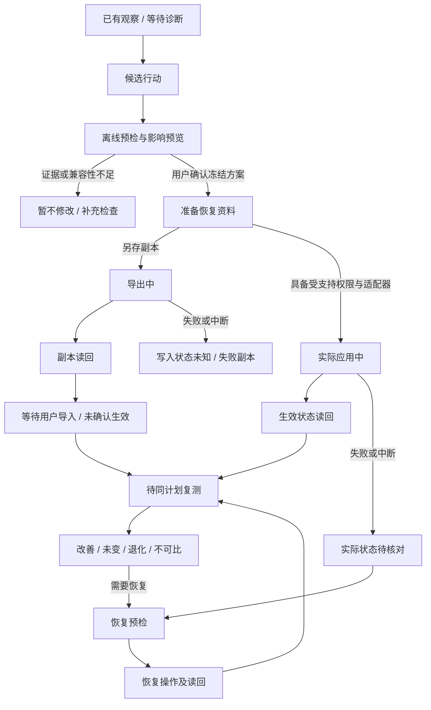

# DNS 修复工作流规范

> 类型：规范；状态：Active；范围：0.6.0现状或明确标注的目标要求；维护：项目维护者；核对：2026-10-23。
> [文档导航](../README.md) · [当前验证](../testing/CURRENT-STATUS.md)。文内反引号文件路径若无说明均相对项目根。

日期：2026-10-22。用户已确认基线。0.5.0 已实现来源明确的条件建议、写后读回、有界核验、用户手动导入记录与生成时基线关联。未实现控制客户端、系统设置直接写入或自动恢复。以下完整工作流是验收方向，实际范围以 [0.5.0 记录](../releases/0.5.0/REVIEW.md) 为准。

## 1. 产品目标与判断原则

目标是帮助用户找到适合自己环境、可预览、可恢复的调整，并验证调整后的有限结果。修复能力应覆盖“解释 → 候选行动 → 预检与影响预览 → 备份与应用 → 读回与同计划复测 → 必要时恢复”，不能以替换一组 DNS 地址代替整个流程。

一个解析错误可能来自输入域名、查询类型、Android API、系统配置、代理规则、服务过滤、缓存或连接条件。不同原因需要不同动作。自动化适合执行已确定范围的步骤，不适合在证据缺失时替用户断言根因。

必须分别呈现四个问题：

1. 看到了什么：某次查询的结果、错误类别、文件中的配置。
2. 打算改什么：明确目标、字段、权限与可能损失。
3. 实际完成了什么：生成了副本、写入了文件，还是客户端确认加载。
4. 验证了什么：相同探针的可用性变化，以及仍然缺少的路径证据。

“已修复”“安全”“无泄露”不能作为通用完成文案。即便同计划复测从失败变为返回地址，也只能报告这次可用性观察改善；不能自动归因、证明所有域名可用，或证明其他应用没有 DNS 泄露。

## 2. 当前能力与缺口

| 能力 | 当前源码行为 | 尚不能声称 |
|---|---|---|
| 运行诊断 | 系统 DNS、明确选择的原始 UDP/TCP DNS、可选 HTTPS 来源回显；系统错误新增固定类别和数字代码 | 观测了全机、真实 DNS 物理路径或所有业务 |
| 配置审查 | 离线读取用户所选 UTF-8、256 KiB 以内的有限 Mihomo / Clash.Meta YAML；拒绝重复键、锚点、合并及不支持结构 | 文件是客户端当前生效配置、适配所有核心版本 |
| 方案生成 | 局部修改五类 DNS 字段，重新解析输出并核对非目标配置；保留节点、规则等其他原文 | 自动修好分流、TUN、IPv6、Fake-IP、全部 fallback / policy 分支 |
| 保存副本 | SAF创建新文件后有界读回、核对摘要和结构；冻结导出内容；拒绝同 URI 或同提供者 document ID 的原件；异常时提示可能有不完整副本 | 所有提供者别名都能识别、通用原子写入、读回失败时仍可称已核验 |
| 客户端应用 | 用户手动导入，并检查客户端 DNS 覆盖和订阅更新 | 已写入另一应用、客户端已经加载或重启 |
| 系统设置 | 复制所选服务主机名，打开网络或 VPN 设置入口 | 已修改 Android Private DNS 或 VPN 配置 |
| 对照 | 同进程保留基线，冻结原计划复测；比较两份实际报告 | 跨进程可靠恢复基线、对改善作因果判定 |
| 会话恢复 | `RepairSession` 在应用进程内；旋转由应用对象保留内容；进程重建后旧文件窗口回调失效 | 重启后能继续旧导出、自动恢复配置或回滚外部客户端 |

现有配置方案会设置 `dns.enable=true`、以所选服务 DoH 替换 `dns.nameserver`、设置 `dns.respect-rules=true`。受支持且非空的 `default-nameserver`、`proxy-server-nameserver` 原列表会保留；缺失或空列表时分别补数字 IPv4 引导与所选 DoH。H3 等冲突会拒绝自动生成。这是一个固定的窄范围模板，不是针对诊断根因自动生成的最优方案。

0.5.0 将生成时的 YAML 重新解析与保存后的文件读回分开：后者有界读取并比较 SHA-256/字节数，再解析。界面初始要求明确选择 DNS 方案，内部 `providerIndex=0` 不构成推荐。两种核验都不等于读取客户端运行状态。

源码依据：[MihomoConfigDoctor](../../core/src/main/kotlin/dev/proxyaudit/core/MihomoConfigDoctor.kt)、[RepairSession](../../app/src/main/kotlin/dev/proxyaudit/android/RepairSession.kt)、[RepairActivity](../../app/src/main/kotlin/dev/proxyaudit/android/RepairActivity.kt)、[ReportComparison](../../core/src/main/kotlin/dev/proxyaudit/core/ReportComparison.kt)。

## 3. 能力、权限与证据边界

### 3.1 分开四种动作

| 动作等级 | 用户看到的准确名称 | 普通安装 App 能做什么 | 需要额外条件的部分 |
|---|---|---|---|
| 解释 | 查看原因范围 / 补充检查 | 读取已有本应用证据、离线审查用户所选文件 | 读取第三方日志需该客户端主动提供或用户选择文件 |
| 设置引导 | 打开设置，手动调整 | 打开公开设置入口、展示原值记录模板与操作步骤 | 无法凭打开页面证明设置已改变 |
| 配置副本 | 生成预览 / 保存配置副本 | 通过用户选择的 SAF 文档授权读写指定文件 | 不等于获得另一应用的私有目录、导入或控制权限 |
| 实际应用 | 应用到指定客户端 / 更改指定系统项 | 仅在目标客户端提供可验证、授权的公开接口时考虑集成 | 系统级更改需要匹配平台管理权限；ADB / Shizuku / root 不能默认假定可用 |

SAF 的授权是特定文档访问；官方 `ACTION_CREATE_DOCUMENT` 设计为新建文档、同名时追加编号。仍应保留本应用的原件保护、写后读回和提供者异常处理，不能把文档 API 当作跨应用配置事务。[Android SAF](https://developer.android.com/training/data-storage/shared/documents-files)

普通应用不得承诺“一键修改全局 Private DNS”。`WRITE_SECURE_SETTINGS` 官方标注不供普通第三方应用使用；`DevicePolicyManager.setGlobalPrivateDnsModeSpecifiedHost` 只允许设备所有者调用。企业受管设备模式必须独立设计，不能让个人设备为完成诊断而默认转为受管设备。[权限定义](https://developer.android.com/reference/android/Manifest.permission#WRITE_SECURE_SETTINGS)、[设备所有者接口](https://developer.android.com/reference/android/app/admin/DevicePolicyManager#setGlobalPrivateDnsModeSpecifiedHost(android.content.ComponentName,%20java.lang.String))

### 3.2 默认能力与可选扩展（特权和客户端写入尚未实施）

| 层 | 适用目标 | 必要边界 | 本轮定位 |
|---|---|---|---|
| 普通 App | 个人设备日常诊断、离线配置副本、手动设置恢复 | 不创建替代 VPN，不隐式绕过当前 VPN，不访问未授权文件 | 默认产品形态 |
| 受控验证服务 | 自有 HTTPS 回显、独立 DNS 权威查询关联或实验网关观测 | 用户明确选择目标；最小查询标识、保留期限与来源范围；不上传完整代理配置 | 后续可选验证能力，不是系统写入权限来源 |
| 客户端适配器 | 指定客户端公开导入/控制接口 | 验证客户端身份与版本、接口权限、加载回执、读回与恢复；接口认证材料仅本地处理 | 先支持一个明确客户端，再逐个扩展 |
| ADB / Shizuku | 用户自行启用的专业实验或维护 | 列出逐项命令/能力和影响；检测权限撤销、服务停止、重启；不执行来自配置的命令 | 非默认、独立扩展方案 |
| root | 授权实验设备上需要的额外观测或恢复 | 单独安全审查与恢复演练；不能声称能克服所有 SELinux、厂商和客户端约束 | 暂不排入默认路线 |

Shizuku 的启动与权限受设备、启动方式和系统限制影响；非 root 启动可能需要重启后重新启用。是否存在 Shizuku 服务不能代替逐项能力检查。[Shizuku 官方使用说明](https://shizuku.rikka.app/guide/setup/)

不要为了“帮助当前 VPN 修 DNS”自动启动本应用的 VPN：Android 同一用户/工作资料仅有一个活动 VPN 服务，启动新的服务会停止已有服务，改变被测对象。[Android VPN 指南](https://developer.android.com/develop/connectivity/vpn)

### 3.3 证据标签，不设综合安全分

| 标签 | 支持的表述 | 不自动推出 |
|---|---|---|
| `FILE_INSPECTED` | 所选文件存在这些字段或冲突 | 当前客户端正在使用它 |
| `COPY_READBACK_VERIFIED` | 新副本读回与冻结输出一致 | 客户端已导入、规则已生效 |
| `APPLY_ACKNOWLEDGED` | 某个已认证客户端接口接受了请求 | 生效配置内容和路径均正确 |
| `EFFECTIVE_STATE_VERIFIED` | 指定接口读回的生效字段符合预览 | 所有流量都遵守这些字段 |
| `APP_RETEST_OBSERVED` | 本应用相同计划下的有限结果 | 因果修复成立、全机无泄露 |
| `EXTERNAL_PATH_OBSERVED` | 指定时段、标识和观测点上的路径证据 | 观测范围之外的应用、协议和网络安全 |

这些标签是独立证据，不能按流程自动补齐。例如没有客户端接口也能复测，但必须保留“生效配置未确认”。用户说“已导入”另记为用户确认，不等同接口读回。

## 4. 先诊断，再形成候选行动

默认先利用已有证据；任何新增联网预检列出目标、域名、协议和数量，经用户选择后执行。不能以“自动修复”名义测试所有公共解析器、收集应用列表或上传配置。

| 现有观察 | 下一步优先检查 | 暂不应自动做 |
|---|---|---|
| 旧版只有 `DNS_FAILURE`，耗时很短 | 用有详情的版本复测；确认域名、系统 API 错误类别和网络稳定性 | 根据 3 ms 推断污染、封锁或改全部 DNS |
| `LOCAL_EXCEPTION` / 参数或权限异常 | 输入校验、API 使用、应用权限与版本兼容性 | 用更换解析器掩盖应用错误 |
| `ERROR_SYSTEM` 与数字 errno | 保存错误码，核对默认 DNS 网络、查询提交与系统状态；必要时提供适配后的操作指引 | 仅凭 errno 对 VPN、运营商或服务器定责 |
| NXDOMAIN | 域名拼写、是否确实存在、私有域名与过滤策略 | 把“收到响应”当作解析可用，或盲目替换公共 DNS |
| NOERROR 无地址 / 仅缺 AAAA | 查询类型、别名链、是否有该类型记录和工具支持范围 | 关闭 IPv6、切 Fake-IP 或宣布 IPv6 已被安全阻断 |
| 原始 A 成功而系统失败 | 先确认同域名；系统会自行选择 A/AAAA，缓存与规则也可能不同 | 将原始目标当成系统解析器，自动改系统 DNS |
| UDP/TCP 差异 | 保留两协议响应码、TC、错误及目标；在相同环境复测 | 将 TCP 成功等同于加密、安全或故障根因已确认 |
| DNS 返回地址但 HTTPS 失败 | 目标是否可连接、证书、回显协议与实际出口要求 | 先改 DNS 供应商 |
| 企业/局域网域名失败 | 识别是否依赖内部解析器、VPN 分流或搜索域 | 替换为只面向公共名称的统一上游 |
| 网络切换、取消、缺少快照 | 等稳定后完成同一计划 | 将缺失结果写为退化或阻断成功 |

Android 的类型未指定 `DnsResolver.query` 会按连接能力选择 A/AAAA；`onAnswer` 携带的响应码仍需解释。错误详情用于缩小调查范围，不构成路径证明。[DnsResolver](https://developer.android.com/reference/android/net/DnsResolver)、[回调定义](https://developer.android.com/reference/android/net/DnsResolver.Callback)

每个候选行动需显示：关联观察、适用条件、拟改善的具体指标、受影响范围、未覆盖范围、所需能力、恢复方法、证据缺口。允许给出“暂不修改，补充证据”作为首选行动。

## 5. 六阶段交互目标（部分已实现）

### A. 诊断与目标

显示一个简短问题陈述，例如“本应用系统解析未取得地址，原始查询取得了地址”。先让用户确认想解决的是连接恢复、指定域名、加密解析配置，还是路径核验；这些目标不能共用一个“安全完成”标准。专业详情折叠显示代码、版本、前后快照与源报告链接。

同时标明本次诊断的查询名是否相同。脱敏报告可在后续设计中保存“不暴露域名的相等关系”，但旧记录两个 `[REDACTED]` 不能据此认定相等。该扩展尚未实施。

### B. 候选行动

只列与已知观察相关的少量行动，每个行动标注“仅解释”“手动设置”“导出副本”或“通过指定接口应用”。默认保留现有可用配置；存在企业解析、局域网名称、过滤要求或复杂策略时，先做针对性审查。

专业用户可展开为什么推荐、哪些事实未知、替代方案。不要按“风险分数”自动排序提供者，也不要因为某次延迟较低就给出长期可靠性结论。

### C. 预检与影响预览

预检分为离线与联网两种。离线检查当前输入摘要、配置类型、客户端/核心版本是否已知、目标字段兼容性、依赖和恢复资料。联网预检若需要 DoH/DoT，不得用 UDP 53 成功冒充完成；当前 App 尚无 DoH/DoT 探针，必须标为未检查。

预览至少包含：

- 待改字段、原值的脱敏摘要、新值、改变理由，以及故意保留的分支。
- 是否新增 DNS 服务域名、明文引导查询、节点解析依赖、指定出口或循环风险。
- 对企业/局域网域名、过滤策略、Fake-IP、IPv6、现有路由和客户端覆盖的潜在影响。
- 核心版本和客户端最终覆盖未知时，显示未验证，不从 YAML 解析成功推导兼容。
- 操作方式及目标：另存副本、进入系统设置，或经授权适配器写入；不要混成一个“应用”按钮。
- 预计中断、恢复入口、可恢复的数据是否已存在。没有可用恢复路径时不能进入自动实际写入。

确认必须绑定冻结的源摘要、方案摘要、目标客户端/文档和能力。输入、目标、提供者或源配置改变后，旧确认失效，需要重新预览。实际写入前再核对源版本，防止订阅刷新或用户手改后覆盖新状态。

### D. 备份与应用

只导出副本时保留原件，并明确它是否已经被用户单独保存。当前进程内 `source` 不是可靠备份；输出成功也不保证用户仍能找到原件。

未来实际写入必须先取得可读的原状态与恢复指引，验证备份能够读回。客户端配置、全局 DNS 覆盖和系统 Private DNS 是不同对象，分别记录恢复原值；对无权读取的部分要求用户记录，标注未独立验证。

副本路径：创建新文档 → 写入冻结输出 → 关闭流 → 有界读回 → 校验字节摘要及解析 → 标记“副本已验证，尚未导入”。提供者不支持读回时只能标记“已写入，读回未确认”；写失败或输出截断时标记失败副本，不能进入导入建议，也不自动删除用户文件。

实际客户端路径：仅通过适配器支持的校验/应用接口 → 收取回执 → 单独读回生效状态。先记录操作意图再发起写入；断线或应用退出后不能盲目重放同一操作。接口若不支持事务或读回，要明确降级到手动导入。

### E. 读回与同计划复测

三种读回分别记录：副本字节、客户端生效配置、系统可观察状态。只具有某一种时不补写其他成功标签。

用户返回 App 不触发自动流量。展示冻结的原计划，经用户确认后复测；域名、原始 DNS 目标 IP/端口、类型、协议、HTTPS 目标、策略和超时保持一致。当前网络 DNS 变化时，基线原始目标仍不应被悄悄换掉；如果旧虚拟 DNS 已不适用，另建新计划并明确不可比。

延续现有比较边界：演示、版本不同、未执行、取消、记录不完整、运行内不稳定，或两次之间网络/传输/VPN/链路条件改变时不可比。两次之间仅 DNS 配置改变，可以并排比较相同探针的可用性，但不能据此自动归因。当前已收到的 0.3.0 报告不能与 0.5.0 报告伪装成严格同版本前后对照，应在新版重新建立基线。

结果文案只允许：“观察改善”“观察未变”“观察退化”“有改善也有退化”“不可比”。原始响应、错误和未覆盖范围始终保留，不能用一张绿色卡片替代。

### F. 恢复

进入设置或导入前就准备离线恢复卡，包含原配置位置、原模式、打开本地设置/客户端的方法。联网断掉时仍可读，不依赖云端下载备份。

出现断网、导入失败或明显退化，优先恢复本次确切改变的状态，再复测。不要自动关闭 VPN、取消始终开启/阻止未连接流量、关闭证书验证，或把 Private DNS 退回一个未曾记录的模式；这些动作可能破坏用户原定隐私策略。

有权限的自动恢复也须满足“当前状态仍是本次写入版本”才能覆盖；发现第三方修改先暂停，让用户选择。恢复写入成功、恢复读回一致和网络恢复是三个不同结果。没有读回能力时只能提供恢复步骤，不能显示“已恢复”。

## 6. 工作流状态机与结果模型（拟实现）

内部状态与界面措辞一一对应。配置副本路线与实际写入路线分开：

| 内部状态/结果 | 进入条件 | 界面必须表达 |
|---|---|---|
| `PLAN_READY` | 离线方案已生成，尚未执行 | 修改预览已生成 |
| `COPY_WRITTEN_UNVERIFIED` | 输出流完成但未完成读回 | 文件已写入，内容待核对 |
| `COPY_READBACK_VERIFIED` | 输出字节摘要与冻结输出一致 | 副本已核对，尚未确认导入 |
| `USER_REPORTED_APPLIED` | 用户称已经导入/调整 | 用户已确认操作，生效状态未独立核验 |
| `APPLY_ACKNOWLEDGED` | 受支持适配器返回成功回执 | 客户端接受操作，正在核对 |
| `EFFECTIVE_STATE_VERIFIED` | 生效字段读回符合预览 | 指定配置已确认，运行效果待复测 |
| `RETEST_*` | 有两份报告及可比性判断 | 展示具体观察，不使用全局“修复成功” |
| `RECOVERY_REQUIRED` | 失败、退化或进程中断后状态未知 | 核对当前状态或按恢复卡操作 |
| `RESTORE_READBACK_VERIFIED` | 原状态已读回确认 | 设置已恢复，网络效果待复测 |

“无变更”也不是“已修复”；它表示该模板没有新字段可写。取消发生在写入前可记 `CANCELLED_NO_WRITE`；写入开始后不能笼统记“取消且未改变”，必须检查是否留下副本或部分状态。每个外部步骤有操作 ID、阶段和完成条件，旧回调不得推进新方案。

建议数据按职责拆开：`RepairCase` 关联症状与基线；`ActionPlan` 保存动作、条件、冻结摘要与恢复引用；`ActionExecution` 保存操作阶段、回执和读回；`RetestComparison` 保存两份报告及结果。敏感原文不进入普通事件日志。以上类型为文档提案，当前未实现。

## 7. DoH 引导、代理与系统 Private DNS

DoH 上游写成域名时，先要解析服务域名。新增数字 `default-nameserver` 解决的是引导依赖；当前模板新增的普通数字 IP 引导仍是明文 DNS。不能把 DoH URL 出现在文件里等同于所有解析均加密。既有策略可能先于普通上游，`respect-rules` 也只遵守已有规则，规则可能直连；节点解析器要避免“连接代理需要先通过该代理解析节点”的依赖循环。Mihomo 对这些字段和 H3 组合的说明应作为预检依据，而不是通用自动套用的证明。[Mihomo DNS 文档](https://wiki.metacubex.one/config/dns/)

因此预览需要画清楚三个逻辑依赖：业务域名由谁解析、DoH 服务域名如何引导、代理节点域名如何解析。暂时无法确定某条边时写“未确认”，不要替用户猜一个代理组；复杂规则允许保留原状或转人工。

系统 Private DNS 与 VPN 核心 DNS 不应同时自动更改。先识别用户要调整的对象；一次操作只改变一层，然后复测。Private DNS `false` 不等于泄露，`true` 也不证明原始 UDP/TCP 探针已加密；VPN 虚拟 DNS、客户端劫持/覆盖、系统策略会影响实际行为。不能把历史特定 Android 版本的说明直接推广到所有设备。

系统提供商主机名模式填写主机名而非 DoH URL；例如 Google 官方配置使用 `dns.google`。菜单因系统版本和厂商而异，当前产品保持公开设置入口加手动说明。更改前记录原模式，解析中断后优先恢复原值。[Google Android 配置说明](https://developers.google.com/speed/public-dns/docs/using)

## 8. 个性化选择，不预设统一供应商

推荐首先依据需求和兼容性，再考虑用户愿意验证的候选，而非列表第一个或一次测速结果。

| 用户条件 | 优先策略 | 需要确认的影响 |
|---|---|---|
| 现有方案可用，只想调查异常 | 保留配置，补充有针对性的证据 | 不为让提示变绿而换 DNS |
| 企业、校园、局域网或内网域名 | 优先原受管解析与明确分流 | 公共服务可能没有私有区域记录 |
| 明确要求威胁过滤 | 说明候选过滤政策，再由用户选择 | 阻断结果与名称不存在/异常需区分 |
| 希望减少内容过滤 | 展示服务策略及未验证范围 | 不提供“绝不过滤”或永远可达的承诺 |
| IPv6-only、受限链路或已有代理 DNS 依赖 | 先验证相应地址族、协议和引导方式 | 现有固定数字 IPv4 模板并非通用方案 |
| 自建或受信解析器 | 后续支持经过同等校验的自定义服务方案 | 证书、引导、认证参数和 secret 管理需要单独设计 |

Cloudflare 标准 `1.1.1.1` 官方标注无内容过滤；Quad9 `9.9.9.9` 是威胁阻断服务，两者不是同策略的可互换测量基准。Google 也是可选公共服务，不构成本产品的默认最优解。服务条款、保留策略和当前网络可达性仍需用户了解；本产品不把它们换算成统一安全分。[Cloudflare 服务区分](https://developers.cloudflare.com/1.1.1.1/ip-addresses/)、[Quad9 服务表](https://docs.quad9.net/services/)

拟把修复模板选择改为明确的“保留现状 / 已有可信服务 / 选择公共服务”，公共服务需要显式选择。保留现状与自定义服务属于计划能力；现有修复器仍使用固定预设。

## 9. 进程重启、恢复记录与 secret 取舍

当前选择：源 YAML、方案与待导出正文只在应用进程中；Activity 保存的只有文件操作身份，不保存正文。进程死亡后需重新选择配置，旧回调不得写入。此做法减少持久化凭据，但不能提供自动恢复。节点密码、令牌、订阅地址仍存在完整导出副本中；选择云文档提供者可能由提供者上传，不能把“App 不上传”说成“文件绝不会离开设备”。

只有后续明确启用持久恢复或实际写入适配器时，才建议采用下述两层恢复记录；当前均未实现，不属于全局 P0 默认落盘范围。普通诊断和离线副本流程继续以不持久化敏感内容为默认，启用恢复存储需另行确认：

1. 启用上述能力后的最小操作日志：仅保留随机操作 ID、动作类型、阶段、时间和是否需要用户核对；不含 YAML、文件 URI、主机名、密码、请求正文。源摘要和配置标识若用于跨会话恢复，也按潜在关联标识留在本机，不默认进入共享报告。
2. 可选完整恢复包：用户明确启用后，应用私有存储加密保存原状态与必要引用，限定保留期限，提供删除入口；密钥使用 Android Keystore，排除系统备份和迁移。解密、密钥失效或 URI 授权丢失时转手动恢复，不降低验证要求。Keystore 保护密钥，不保护已解密到进程中的正文，也不保证被攻陷进程无法调用密钥。[Android Keystore](https://developer.android.com/privacy-and-security/keystore)

选择持久 URI 权限前说明用途与撤销方式；文档授权、网络端点 token 与配置密钥分别管理。默认不把完整配置放剪贴板、通知、崩溃日志、SavedInstanceState 或可分享诊断 JSON。现有 App 禁止备份的声明应保留，但未来增加存储仍须针对实际文件与迁移规则验证。

重启后恢复规则：只读检查上次阶段 → 获取仍然有效的权限 → 核对原状态/输出状态 → 给出继续、重新生成或恢复选项。绝不依据“上次确认过”自动重放写入。若在写入阶段崩溃而无法确认目标，显示“状态待核对”，不能默认为成功或失败后安全回滚。

## 10. 可实现优先级与验收（后续扩展设计后排期）

本节遵循 [产品基线](../product/PRODUCT-SPEC.md) 的全局阶段：P0 为演示回归与 UI 规范/导航基础，P1 为证据获取、冲突与尝试记录，P2 为完整修复闭环，P3 为扩展协议与外部取证，P4 为特权能力。修复内部用 R0/R1/R2 排序，不能把修复的新功能并入用户首先确认的全局 P0。P1 的证据记录是本工作流的依赖，由对应规范安排。

| 修复优先级 / 全局阶段 | 交付 | 必须通过的验收 |
|---|---|---|
| R0 / 全局 P0 | 现有文案与状态名称纠正，配合全局演示回归与导航规范 | 当前导出只能称配置副本；打开设置不能称已应用；不新增实际写入或恢复能力 |
| R1 / 全局 P2 | 候选行动卡、明确动作层级和影响预览 | 文件导出、手动确认、客户端生效和复测有不同状态；NXDOMAIN、API 异常和 Private DNS=false 不触发统一换 DNS |
| R1 / 全局 P2 | 副本写后有界读回与原件保护 | 正常提供者读回一致；截断、错误读回、无读权限、同原件 URI、别名和失败副本均有明确结果；原件摘要不变 |
| R1 / 全局 P2 | 同计划复测闭环与离线恢复卡 | 原目标冻结；新版重建基线；未执行/取消/环境改变不可比；断网仍能找到原配置和设置恢复步骤 |
| R1 / 全局 P2 | 独立的兼容性与依赖预检 | 按明确核心/客户端版本样本验收；H3 冲突、引导和节点循环、policy/fallback 未覆盖范围可见；不通过“关闭证书校验”让方案通过 |
| R2 / 全局 P2，需单独确认 | 可选恢复包与重启恢复 | 在选择、生成、写入、读回、客户端应用和复测各阶段模拟进程终止；旧回调不写新方案；密钥/权限丢失时安全转人工 |
| R2 / 全局 P2，需选定客户端 | 一个客户端的授权适配器 | 身份/版本确认，预检、原状态备份、幂等或重复调用防护、生效读回、竞争修改保护和失败恢复全部可演练 |
| 后续 / 全局 P3 | 有限 DoH/DoT 验证及自定义服务方案 | 单独协议实现与协议测试；目标和数量可见；公共查询明确确认；不能把 UDP/TCP 53 结果记成加密协议成功 |
| 后续 / 全局 P3 | 可选受控路径证据服务 | 关联标识、防缓存设计、服务声明边界、最小日志和删除机制明确；仅对实际观测点下结论 |
| 独立评估 / 全局 P4 | ADB / Shizuku / root 模块 | 权限逐项检查，明确启停与撤销，重启/失联/权限丢失演练；不成为普通使用前提 |

当前状态：R0与R1的写后读回、专业基线复测和恢复说明已有实现；候选动作与兼容预检仅覆盖当前受限模板，不能称完整R1验收完成。R2持久恢复/客户端写入、P3独立协议/外部服务与P4模块尚未实现。既有ADB真机调试是开发环境协作，不是App已内置ADB模块。

验收首先使用离线夹具和受控本地端点；公共网络与真实客户端写入单列为用户确认后的能力验收，不能把主机测试通过当成真实设备行为保证。本文件本轮未报告新增测试通过；本节未实现的扩展尚未启动，已实现项以版本记录和当前验证为准。

## 11. 后续扩展设计的产品决策

P0与已实施的写后读回、恢复说明、手动导入记录不再要求重复确认。新增持久恢复或客户端实际写入仍按具体方案推进；副本导出不能称为客户端已生效。下表区分既有基线与后续扩展：

基础设计建议采用以下三项默认，不要求用户本轮逐项回答；批准产品方向也不自动启动对应的后续实现：

| 基础项 | 推荐默认 |
|---|---|
| 能力形态 | 普通 App，解释、设置引导与配置副本优先；不默认要求 ADB / Shizuku / root |
| 服务选择 | 保留现状优先，公共服务显式选择；自定义服务留待专业能力扩展 |
| 恢复与存储 | 保留已实现的写后读回和恢复说明，再评估完整加密恢复包；默认不持久化完整配置 |

未来扩展到实施前再选择：实际应用适配器要选定具体客户端与版本，未选定前不承诺通用“一键应用”；DoH/DoT 与受控后端涉及新的目标、流量与服务依赖，进入全局 P3 时再确认范围。特权模块到全局 P4 单独评估。本轮无需为这些未来选项提前作出授权。

确认后以可验收的小阶段实施；任何阶段都允许用户停在“已解释、未修改”或“副本已保存、尚未应用”，这些都是有效完成状态。

## 0.6.0 接入范围

当前基线和修复关联来自专业链 RunReport（app.controller.baseline）；DeepReport 尚未接入该闭环。本文后续完整状态机、外部客户端生效回执与持久恢复仍是要求，不能当作已有能力。已确认的写后读回、手动导入记录和基线关联不再作为待确认事项；未实现项按当前问题账本推进。
